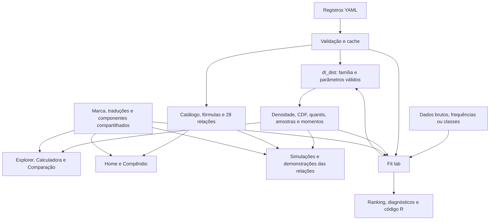

# distlab: arquitetura e continuidade

Leitura consolidada por Sol/Codex em 2026-11-01, a partir do histórico completo
até `21b1fc5`, dos fontes, registros YAML, ativos e testes locais. O lote 6
está implementado e validado localmente em `codex/fit-lab`; o GitHub remoto não foi consultado
para afirmar estado de PR ou CI.

## O produto e sua unidade central

O distlab é um laboratório didático em R/Shiny. Uma distribuição aparece
como história, fórmulas com condições, gráficos, cálculos, relações e
experimentos reproduzíveis. O Fit lab acrescenta o caminho inverso: partir
dos dados para estudar quais distribuições podem descrevê-los.

A unidade central é a entrada em `inst/registry/<id>.yml`, lida por
`R/registry.R`. Os 21 registros atuais descrevem 13 distribuições contínuas e
8 discretas. O registro reúne nomes e história em dois idiomas, tipo,
grupo/família, suporte, domínio e valores iniciais dos parâmetros, funções R,
fórmulas, referências e relações. O catálogo não é uma lista independente da
interface: as páginas e o motor leem essas mesmas entradas.

## Como o Claude construiu a base

| Etapa | Entrega e evolução observada |
|---|---|
| Estrutura inicial | Pacote R, registro, motor, momentos, idiomas e Explorer. |
| Lote 1, PR #1 | 21 famílias T1; suporte dependente dos parâmetros; distinção entre momentos infinitos e inexistentes; folhas de fórmulas e validação mais rigorosa. Correções de Beta-binomial e faixas de caudas pesadas. |
| Lote 2, PR #2 | Marca Curva, fontes locais, shell, Home, idioma sem perda de estado e fórmulas KaTeX. Ajustes de contraste, créditos e Explorer. |
| Lote 3, PR #3 | Compêndio com mapa, lista acessível de relações, cartões e tabela. Filtros compartilhados e seleção diferida até o mapa ficar visível. |
| Lote 4, PR #4 | Calculadora e Comparação; probabilidades com extremos abertos/fechados, precisão de caudas, parser decimal e presets/sweeps válidos. |
| Lote 5, quatro commits locais | Motor de simulação, seis abas, demonstração para cada aresta, sementes e código R. Refinamentos finais de histogramas em retículas, falta de memória, ruído esperado de TV, idioma e celular. |

O histórico demonstra rodadas de implementação e correção numérica/visual.
Manter o estilo inclui preservar essas decisões, não só a formatação do R.

## Camadas e relações entre os arquivos

| Camada | Fontes principais | Responsabilidade |
|---|---|---|
| Registro | `R/registry.R`, YAML | Validar famílias, domínios, fórmulas e destinos das relações; cache em `.dl_env`. |
| Objetos e funções | `R/dist.R`, `R/families.R` | Construir `dl_dist`; resolver suporte e d/p/q/r; adapters de Bernoulli e Beta-binomial. |
| Momentos | `R/moments.R` | Fórmulas por família e fallback numérico; integração por quantis para suportes com singularidades. |
| Probabilidades e código | `R/prob.R`, `R/calc.R` | Eventos discretos exatos, subtração na cauda apropriada e escala logarítmica, números localizados e R reproduzível. |
| Catálogo e relações | `R/catalog.R`, `R/relations.R`, `R/graph.R` | Uma representação das arestas alimenta o catálogo, cartões, mapa e navegação. |
| Fórmulas | `R/formula.R`, `latex` dos YAML | Peças condicionais, infinito, inexistência e ausência de forma fechada; TeX renderizado por KaTeX. |
| Parâmetros | `R/params.R`, `R/constraints.R` | Sliders compartilhados, memória por distribuição, limites e restrições vinculadas. |
| Simulação | `R/sim.R`, `R/sim_transform.R`, `R/sim_relations.R` | Monte Carlo, LGN, TCL, transformações e receitas por relação; funções independentes da reatividade Shiny. |
| Aplicação | `R/run_app.R`, `R/mod_*.R` | Shell, idioma/tema, roteamento e módulos que apresentam dados do motor. |
| Identidade e cliente | `R/theme.R`, `inst/brand`, `inst/app/www` | Marca, cores, fontes, CSS, assets locais e JS para KaTeX, idioma, cópia, tabelas e mapa. |
| Idiomas | `R/i18n.R`, `inst/i18n/*.yml` | Dicionários planos em pt-BR/en-US; formatação numérica e atualização de textos. |
| Ajuste, lote 6 | `R/fit.R`, `R/fit_data.R`, `R/fit_diagnostics.R`, `R/mod_fit.R` | Dados comprimidos, candidatos, MLE, ranking e diagnósticos ligados às mesmas famílias do registro. |

As 28 arestas atuais são 8 casos particulares, 3 somas, 6 limites e 11
transformações. `edge_ids()` gera identificadores estáveis a partir de
origem, destino e tipo. Cada aresta tem uma receita em `.dl_sim_recipes`;
testes verificam que não faltem receitas nem sobrem arestas desconhecidas.

## Fluxo da interface e estado

`app_server()` mantém o idioma, o tema e um canal `route`. Home, Compêndio,
Explorer e Simulação enviam pedidos de navegação com distribuição,
parâmetros, grupo ou aresta. Os módulos destinatários interpretam o pedido;
o shell seleciona a página. O Fit lab foi integrado nesse mesmo
contrato, permitindo abrir uma distribuição ajustada no Explorer.

Os parâmetros usam identificadores com a família para impedir que um valor
antigo seja aplicado a outra distribuição. Sliders renderizam mesmo quando
ocultos e o código distingue valores resolvidos de entradas do navegador.
Explorer debounced verifica a família antes de apresentar os resultados.

Textos estáticos usam `data-i18n`; o JavaScript recebe o novo dicionário.
Textos dinâmicos e seletores são traduzidos no servidor. Reatividade de
apresentação deve atualizar rótulos sem reiniciar experimentos ou ajustes.
Resultados do Fit são capturados por ações explícitas de carregar/ajustar.
Pedidos de navegação com parâmetros aguardam o eco dos controles do cliente:
entradas antigas de outra visita não podem substituir um ajuste recém-aberto.
Janelas iniciais dos sliders se expandem para parâmetros válidos externos;
a grade se refina até seis casas para exploração de estimativas. O objeto
de ajuste e seu código/dados exportados preservam a precisão completa.

## Invariantes a preservar no lote 6

1. **Mesma parametrização em toda parte.** Gamma usa `shape/rate`, a
   Geométrica conta falhas desde zero e Student t atualmente tem somente
   `df`, com localização zero e escala um. O Fit não pode introduzir outra
   família de três parâmetros sob o mesmo identificador.
2. **Suporte e domínio são distintos.** Um valor inicial de slider não é
   uma restrição inferencial. Parâmetros ajustados continuam sujeitos ao
   domínio matemático e às restrições do registro.
3. **Precisão faz parte do produto.** Usar caudas superiores diretamente e
   log-probabilidades; tabelas agrupadas usam massas de intervalos, e não
   densidades em pontos médios.
4. **Limitações têm significado.** `NA` não é zero. Momentos inexistentes,
   MLE sem solução finita, informação singular, fronteiras e erros de
   convergência precisam permanecer visíveis.
5. **Comparações têm unidade comum.** Não comparar AIC/pesos de densidades
   contínuas com massas discretas para observações pontuais. Frequências
   não devem ser tratadas como pesos arbitrários nem expandidas sem limite.
6. **Reprodutibilidade é verificável.** Código exportado deve reproduzir
   os números. Simulações com semente preservam o fluxo aleatório do
   chamador; mudanças de idioma/tema não geram nova amostra ou novo ajuste.
7. **Estatística e apresentação se separam.** Funções do motor devolvem
   objetos/dados, sem depender de Shiny; módulos formatam e desenham usando
   `plot_theme()`, `plot_layout()`, `format_num()` e os componentes existentes.
8. **Acessibilidade e uso local continuam.** Rótulos, contraste, teclado,
   telas pequenas e estados vazios/erros fazem parte da validação. Fontes,
   KaTeX e identidade já são distribuídos localmente.

## Como os testes sustentam esses contratos

- Registro/catálogo/relações: integridade dos YAML, domínios, suporte,
  classificações e destinos.
- Distribuições/momentos: normalização, d/p/q/r, fórmulas independentes e
  crosschecks com `distributions3` e `extraDistr`; caudas e degenerescência.
- Folhas matemáticas: condições por peça, cobertura de grades, estados de
  existência e valores numéricos transcritos separadamente.
- Relações/simulações: identidades, convoluções, limites, transformações,
  sementes, código gerado e uma receita por aresta.
- Módulos/app: `testServer()`, roteamento, idioma sem perda de estado e
  controles em estados extremos; navegador via pacote instalado.
- Lote 6: referências analíticas para MLE/SE, equivalência entre dados e
  frequências, probabilidades de classes, grupos comparáveis, estatísticas
  EDF independentes e estados/erros da interface.
- CI: cinco jobs Linux/macOS/Windows e versões release/devel/oldrel.

Antes das mudanças funcionais do lote 6, a suíte local passou sem falhas,
com um aviso de cache Sass restrito e o teste de navegador pulado por
exigir instalação. Isso não equivale a validar o lote novo ou o CI remoto.
Resultados posteriores ficam no histórico `COLLABORATION.md`.

## Implementação atual versus intenção do plano

O `PLAN.md` também descreve intenções futuras. A marca já existe; o lote de
Simulação já foi implementado, mas não está integrado na `main` local.
O Fit está implementado e validado localmente, com revisão/entrega remota
pendentes. Cartões multivariados, `dl_report()`, modo
apresentação e exportações gerais são lotes posteriores. A API proposta
`dl_compare()`, `dl_plot_*()` e `dl_code()` não deve ser confundida com uma
API já exportada só porque as páginas correspondentes existem.

O relatório futuro deverá consumir o estado da sessão, incluindo os ajustes.
Por isso o Fit deve guardar dados, parâmetros fixos, estimativas, avisos,
ranking e código em um objeto consistente. Os cartões multivariados também
precisarão de tratamento próprio: o motor atual assume distribuições
univariadas com suporte escalar e tipos `continuous`/`discrete`.
